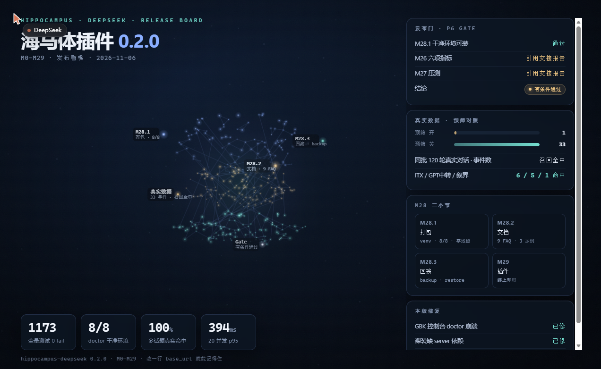

# hippocampus-deepseek

> 给 DeepSeek / DSH 加一个「记得住事」的海马体。**装上即用**，记忆只存本地 SQLite，不训练、不上传。


## 两种用法

### A. DSH 插件（推荐：插入即用）

```bash
dsh plugin --profile <你的profile> add link:<本目录>
# 然后重启 DSH Web
```

插件会自动：拉起本地 Python 内核（包内自带运行时）→ 订阅会话事件写记忆 →
在 `systemPrompt` 里注入记忆段。**不需要改 base_url、不需要手动起服务、不需要 pip install。**

- 记忆库：`~/.hippo/mem.db`
- 抽取 key：自动从 DSH 凭据 / `DEEPSEEK_API_KEY` / `~/.hippo/config.yaml` 读取
- 内核日志：`~/.hippo/kernel.log`

### B. OpenAI 兼容代理（任何客户端）

```bash
pip install hippocampus-deepseek
hippo init
hippo serve
```

客户端把 `base_url` 改成 `http://127.0.0.1:8787/v1` 即可：

```python
from openai import OpenAI
client = OpenAI(base_url="http://127.0.0.1:8787/v1", api_key="sk-...")
```

## 发布看板



深色神经场是手绘 Canvas 三维投影（三层配色分别对应语义 / 情节 / 工作记忆），
**只做视觉呈现，不参与运行时**。打开 `docs/dashboard.html` 可看动转效果。

## 它记得什么

| 层 | 内容 | 怎么来的 |
|---|---|---|
| 事实 | 住哪、过敏、生日、职业…… | 抽取时写进 `facts`，带生效时间 |
| 事件 | "上个月搬家""老王来杭州" | 每 5 轮抽一次窗口，存摘要 + 关键词 + 原文 |
| 人物 | 关系、称呼、特征 | 从对话里认实体，别名自动合并 |
| 情绪 | 六维心情 + 惯性衰减 | 由事件唤醒度驱动，不调模型 |
| 想问的 | "你搬家搬完了吗" | 从记忆缺口里长出来，每天最多 3 句 |

**不记得**：没聊过的、被用户删掉的、超过半衰期的琐事（hot 3 天 / warm 30 天，
重要的 180 天）。

## 成本

数字来自 `python -m hippo.tools.cost_report`，token 取自 200 轮实测
（573 token/轮），价格按 DeepSeek 官方价，前缀缓存命中 72%。

| 档位 | 轮/天 | 月 token | 月成本 |
|---|---:|---:|---:|
| 轻度 | 20 | 434,040 | **¥1.08** |
| 中度 | 100 | 2,170,200 | **¥5.41** |
| 重度 | 500 | 10,851,000 | **¥27.04** |

- 模型调用只出现在**抽取**（每 5 轮一次窗口）和**心跳升级**；其余全是规则/统计。
- 超预算自动降级（停止抽取、只装人设/钉住/时间锚），次日 00:00 恢复。

## 备份与恢复

```bash
hippo backup             # VACUUM INTO 快照，保留最近 7 份
hippo restore --latest   # 先停 serve，再用最近一份恢复
hippo doctor             # 恢复后自检
```

## 配置

插件配置在 profile 的 `cordis.patch.yml`（端口 / dbPath / apiKey / pythonPath）；
代理形态的配置在 `~/.hippo/config.yaml`。最常改的三个：
`deepseek.base_url`、`deepseek.api_key`、`extract.prescreen_mode`。

## 常见问题

**怎么删记忆？** `hippo recall "关键词"` 找到 id，然后 `hippo pin --event N` 或直接删库里的行；归档用 `hippo archive`。

**为什么它说记不清？** 检索没命中（换个说法再问）、或那条记忆已经衰减到 cold。`hippo why "你那句话"` 能看到预筛为什么放行/挡掉。

**换模型怎么办？** 改 `deepseek.model` 和 `extract_model` 即可；抽取对模型不敏感，温度固定 0.2。

**缓存为什么没命中？** 先跑 `python -m tools.probe_cache --offline`；见 `reports/R-13.3.md`。

**装不上怎么办？** 先 `hippo doctor`：Python ≥ 3.11、SQLite ≥ 3.34 且编入 FTS5 trigram。Windows 请用 python.org 安装包（商店版是占位 stub）。

**会不会上传数据？** 不会。记忆只写本地 SQLite，记忆内容只出现在你这一轮的 prompt 里。

**能不能多设备同步？** 不能自动同步。把 `~/.hippo/mem.db`（或 backups 快照）拷到另一台机器同一路径即可。

**换了客户端还能用吗？** 能。DSH 插件形态覆盖 DSH；代理形态覆盖任何 OpenAI 兼容客户端。

**记忆会不会越积越大？** 会衰减；冷记忆 `hippo archive` 归档，`hippo stats --disk` 看占用。

**预筛会不会太严？** M29 起默认 `prescreen_mode: heuristic`（规则 + 信息量），真实对话实测命中 20/20；想更省可切 `rules`，想全抽切 `off`。

## 开发

```bash
pip install -e ".[server,dev]"
python -m pytest -q              # 1173 条
node --test test/plugin.test.mjs test/integration.test.mjs
python -m hippo.tools.eval_real_topics http://127.0.0.1:8792   # 多话题真实评测（需先起内核）
python -m hippo.tools.stress_kernel http://127.0.0.1:8793 20 30 # 压测
```

目录：`hippo/` 内核（Python）、`lib/index.js` 插件宿主半、`runtime/` 包内 Python 运行时、
`examples/` 示例、`reports/` 验收报告、`docs/dashboard.html` 发布看板。

## License

MIT © 2026 Shoren-Syi
