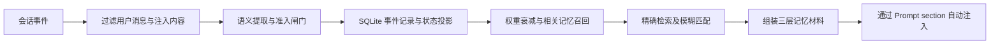

# dsh-plugin-xujie-memory

[English](README_EN.md) | 简体中文

为 DeepSeek Harness（DSH）打造的无感长期记忆插件。

**记忆的价值在于不用想。** Xujie-Memory 自动记录相关信息，并在对话中组装记忆材料、注入提示词，无需模型决定是否调用记忆工具。Windows x64 包含运行时，按安装说明接入后一般无需额外配置。

## 工作流程



事件记录与状态投影支持追溯和重放；情节记忆、人物卡等也有各自的存储结构。默认同步 section 读取缓存，宿主时序可能使本轮看到上一轮材料，详见下方「记忆范围」。

## 与工具调用式记忆对比

| 维度 | 常见工具调用式记忆 | Xujie-Memory |
|---|---|---|
| 模型是否需要决定检索 | 通常需要主动调用工具 | 自动组装并注入，无需模型决定是否调用 |
| 记忆组织 | 取决于具体实现 | 语义、情节、工作三层 |
| 延迟 | 取决于工具调用和实现 | 内核请求有开销；默认同步读取缓存，异步模式会等待材料 |
| 追问控制 | 取决于实现和提示词 | 同一条只问一次，每轮最多一件，默认每会话最多六次 |
| 衰减与模糊召回 | 取决于具体实现 | 支持权重衰减与模糊搜索 |

此表比较常见设计方式，具体工具调用方案的功能和性能可能不同。

装上去之后，DSH 会**在每轮对话里自动**做三件事：

1. 把你说的话判定成事实（欠账 / 偏好 / 称呼 / 承诺），写进本地库
2. 把"这个人是谁、我现在记得什么、他专门交代过要记住什么"注入提示词
3. 你没说清楚的地方，**最多问一次**，问过就不再提

记忆会自动注入；需要主动查找或删除时，也可以使用下方工具。

### 三层记忆（当前版本 0.6.0）

| 层 | 内容 | 你怎么用 |
|---|---|---|
| 语义 | 人物卡、事实、锚点 | 自动注入「关于这个人 / 重要的事」 |
| 情节 | 原话、摘要 | 相关旧事自动浮上来；可模糊搜（错字也能中） |
| 工作 | 最近几句、未确认项 | 自动注入「最近说过的话 / 还没确定的事」 |

**重点标注**：AI 会先自动判断一句话值不值得记——身份、强偏好、承诺、健康/钱/
关系、情绪强度会提高权重（1–5），寒暄天气降低；聊天里说「记住这个」才会
钉成锚点。自动分只决定「淡得慢一点」，5.0 和锚点留给用户明说。

代码/后台也可以用 `POST /memory/mark` 手动标 1–5 级重要性。

**遗忘曲线**：`POST /memory/curve` 看重放出来的权重历史；检索命中不会重置衰减。

**模糊搜索**：`POST /memory/search`，两字词、错一个字都能捞；
精确检索落空时，自动注入也会降级到模糊匹配。

本仓库保留 0.6.0 发布包中的内核；上表概括了三层记忆。

**当前这句不会被当成旧事注回去（0.6 修复）**：`/turn` 用 trace_id 挡，`/context` 只拿得到文本、按内容挡（忽略空白与标点）。换成问别的事，旧记忆照常出现。

---

## 主动工具（0.6 新增）

注入是自动的，但**主动回忆**和**删掉记错的东西**需要有手。0.6 给模型注册了三个工具：

| 工具 | 作用 | 副作用 |
|---|---|---|
| `memory_search` | 按字面/错字模糊检索原话，返回内容、`trace_id`、权重 | 只读 |
| `memory_forget` | 删一条记忆（软删：内容清空、FTS 移除、依赖它的事实失效并重算） | 写，`erased_at` 留审计 |
| `memory_status` | 原话/已删/状态/锚点/未确认计数 + 内核健康 | 只读 |

用户说「忘掉这条」时，模型可以自己搜到 `trace_id` 再删，不需要你手动清库。
对应内核接口：`POST /memory/search`、`POST /memory/forget`、`POST /memory/stats`。

宿主若没有 `tools` 服务（老版本），这三个工具静默跳过，注入照常。目前尚无编辑记忆工具或图形化记忆管理界面。

---

## 装上就能用（用户零动作）

| | |
|---|---|
| DSH | 0.2 预览版（`dsh.bundle` 机制） |
| Node | `^22.19 \|\| >=24` |
| Python | **不用装**：Windows x64 包里自带解释器 |
| 内核 | **不用装**：Python 内核（`python/xujie_memory`）在包里 |

```bash
dsh plugin --profile <你的profile> add <解压后的 dsh-plugin-xujie-memory 目录>
# 新开一个会话即可
```

也可以在 DSH 的「添加插件」中输入包名 `dsh-plugin-xujie-memory` 安装，或通过命令安装：

```bash
dsh plugin --profile <你的profile> add dsh-plugin-xujie-memory
```

也可以从 GitHub 安装指定版本：

```bash
dsh plugin --profile <你的profile> add github:Shoren-Syi/dsh-plugin-xujie-memory#v0.6.0
```

不需要 `pip install`，不需要填 `repoPath`，不需要另外起服务：

- 插件用**包内解释器**（`runtime/win32-x64/python.exe`）拉起**包内内核**
  （`python/xujie_memory`），数据默认落在 `~/.xujie-memory/memory.db`。
- 内核路径 / 解释器路径都在 `lib/index.js` 里按 `import.meta.url` 自解析；
  只有开发时才需要 `repoPath` / `pythonPath` 覆盖。
- 内核挂了只影响"这一轮没有记忆"，**不影响对话**。

> 平台说明：当前包内自带 **Windows x64** 解释器。macOS / Linux 会回退到
> 系统 `python3`（内核零第三方依赖，3.10+ 即可）；要完全零依赖，需要给
> 对应平台补 `runtime/<平台>-<架构>/`。

可选配置（写在 profile 的 `cordis.patch.yml`，一般不用动）：

```yaml
- id: xujie-memory
  config:
    endpoint: "http://127.0.0.1:8765"  # 内核端口
    autoStart: true                    # 由插件拉起内核
    dbPath: ""                         # 留空 = ~/.xujie-memory/memory.db
    statusFile: ""                     # 填文件路径可把挂载/就绪状态写进去（排查用）
    maxAskedTotal: 6                   # 一个会话最多主动追问几次
```

---

## 你会看到什么

材料会变成提示词里的一段：

```
## 关于这个人
- 他说过：偏好不吃辣

## 重要的事（他专门说过要记住，不会随时间淡去）
- 四月十二号那天项目上线，我们熬到凌晨四点。

## 还没确定的事
- 需要确认这句话是不是这个意思
（如果用户当前这句其实已经说清楚了，就当它确认了；否则最多挑一件顺带问一句，别追问）
```

---

## 追问有熔断

| 闸 | 行为 |
|---|---|
| 同一条只念一次 | 念过就标 `asked_at`，第二遍不再进材料 |
| 一轮最多一件 | `TurnBudget.max_questions = 1` |
| 一个会话最多 6 次 | 超过之后材料里只剩一句总数，**不再引导追问** |

熔断之后那些记录还在库里，用户主动提起来时照样能用——**不问 ≠ 忘了**。

---

## 记忆范围

默认 `scope: user`：人物卡、偏好、锚点、账**跨会话有效**——新开会话也认识你。
「最多追问几次」的熔断仍按会话算。

想要 0.4 的行为（每个会话一份、互不相通）就设 `scope: session`；
这种模式下没有会话上下文的组装返回空，绝不串会话。

插件按会话缓存材料（最多 32 个）。注意：`section.text` 是同步读缓存的，
宿主如果在 `/turn` 返回前就拼提示词，本轮用的是上一轮的材料（单轮内核耗时通常 <15ms）。
宿主支持异步 section 时可开 `asyncSection: true`。

## 可靠性

- 看门狗每 5 秒查一次内核，挂了按退避自动拉起；日志在 `~/.xujie-memory/kernel.log`。
- `/health` 返回版本、库路径；端口上是旧版或别的服务就自动换端口。
- 内核跟随宿主进程退出，不留孤儿进程。
- 请求要带 `X-Xujie-Token`（`~/.xujie-memory/token`），并且只收 `application/json`。

---

## 事件（已按真机核对）

`session/event` 里只有 `user/message` 会写记忆：

| 类型 | 插件行为 |
|---|---|
| `user/message` | **写记忆**，正文在 `event.data.content[]` 的 `text` 块里 |
| `assistant/message` | 跳过 |
| `tool/call` / `tool/result` / `step/end` / `turn/start` | 跳过 |

两个容易踩的点，插件里已经处理：

1. **正文在 `data.content` 数组里**，不是 `event.content`。
2. **注入消息也是 `user/message`**（`source.kind = runtime-context` /
   `agent-instructions` 等），它们不是用户说的，会被跳过——否则提示词
   会被当成"用户说的事实"记进库里。

---

## 排查

```bash
# 只想确认插件挂上了、内核起来了：在 profile 配置里设 statusFile，
# 启动后看文件里有没有这两行：
#   info 已挂载，内核在 http://127.0.0.1:8765
#   info 内核就绪（xxxms）：http://127.0.0.1:8765

# 手动跑内核（诊断用；用插件包内的解释器）
runtime/win32-x64/python.exe -m xujie_memory.server --port 8765 --token-file %USERPROFILE%\.xujie-memory\token

# 直接打一轮，看材料长什么样
curl -s --noproxy '*' -X POST http://127.0.0.1:8765/turn \
  -H "Content-Type: application/json" \
  -H "X-Xujie-Token: $(cat ~/.xujie-memory/token)" \
  -d '{"session":"t1","user":"owner","text":"我不吃辣"}'
```

**记忆服务挂了不该让人没法说话。**

---

## 结构

```
dsh-plugin-xujie-memory/
├── lib/index.js          # 薄壳：挂 section / 注册工具 / 收事件 / 起内核
├── python/xujie_memory   # Python 内核（零第三方依赖）
├── python/specs          # 判定规则
├── runtime/win32-x64/    # 自带解释器（Windows）
└── cordis.patch.yml      # bundle patch（DSH 0.2 顶层数组格式）
```

逻辑全在 Python 侧，插件只是个薄壳——DSH 还是预览版，API 会变，
把不稳定的部分做薄。

## 开发验证

`npm test` 运行冒烟、回声、工具及删除后画像对账测试。Windows x64 默认使用包内 Python；其他平台需要 Python 3.10+，也可通过 `PYTHON` 指定解释器。执行 `npm pack` 可打包当前仓库自带的内核。

本仓库由 0.5.0 发布包恢复。原先的回归测试集因之前的沙箱重置而丢失，发布包中也没有包含原来的 `test/kernel_regression.py` 和内核同步脚本。CHANGELOG 中的 31/31 是历史记录，当前仓库无法复现该回归集；冒烟测试不代表这 31 项回归已通过。

