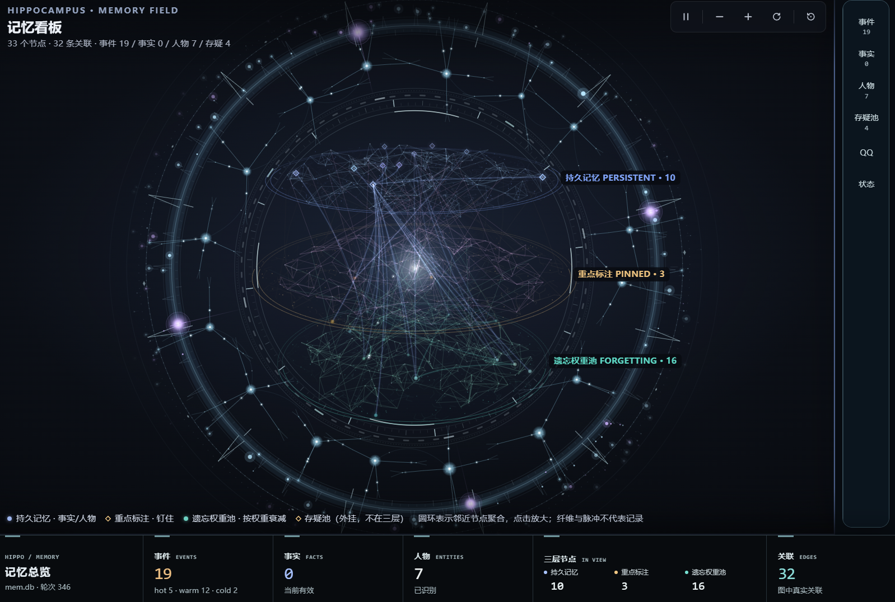

<div align="center">

# 叙界记忆

### 给对话一座可以回看的记忆空间

为 DeepSeek Harness 而做的本地记忆插件。<br>
从对话中整理值得记住的内容，在需要时找回，并在看板里看见它们的联系。

[](https://www.npmjs.com/package/dsh-plugin-xujie-memory)
[](LICENSE)
[](#运行环境)

[快速安装](#快速安装) · [认识记忆看板](#认识记忆看板) · [升级与备份](#升级与备份) · [常见问题](#常见问题)

</div>

---



<p align="center"><sub>记忆看板实机画面 · 节点与数字随你的记忆数据变化</sub></p>

## 让记忆有迹可循

长对话里，重要的信息常常散落在许多轮消息中。叙界记忆接收会话事件，借助模型整理事件、事实与人物信息，在当前会话需要时组装相关记忆。你也可以打开看板，查看、搜索和管理这些内容。

| 能力 | 能做什么 |
| :--- | :--- |
| **自动记录** | 记录对话原文，并在配置 API key 后提取结构化记忆与会话摘要。 |
| **按需召回** | 检索当前会话的事件，并在配置允许时跨会话继承用户事实和特征。 |
| **记忆看板** | 在可交互的空间中查看记忆节点、关联和详情，按类型浏览。 |
| **状态查看** | 查看待处理对话、最近抽取状态和记忆数量。 |
| **可选 QQ 桥接** | 默认关闭，通过第三方 OneBot 协议端配置；目前尚未完成真实 QQ 联调。 |

## 认识记忆看板

看板将记忆组织在同一片空间里：

- 🔵 **持久记忆**：值得长期保留的内容。
- 🟡 **重点标注**：被特别标记或钉住的内容。
- 🟢 **遗忘权重池**：随权重变化管理的记忆。
- ✦ **存疑池**：需要进一步确认的信息，以外围节点展示。

侧栏可切换事件、事实、人物、存疑、QQ 与状态。图中的连线和数量由实际数据决定，截图仅展示界面效果。

## 快速安装

确保已安装 DeepSeek Harness（DSH），并选择要安装的 profile：

```bash
dsh plugin --profile <你的profile> add dsh-plugin-xujie-memory@1.1.19
```

也可以在 DSH 的「添加插件」界面输入 `dsh-plugin-xujie-memory`。安装完成后**重启 DSH**，在侧栏打开「记忆」。

首次使用时，请在 DSH 凭据服务、`DEEPSEEK_API_KEY` 环境变量或插件设置中配置抽取用的 API key。仅登录 DeepSeek 账户不等于配置了 API key；没有可用 key 时，插件仍可记录原文，但不会进行模型抽取。

### 运行环境

Windows x64 安装包内含 Python 运行时，插件会自动启动本地内核。其他平台需要可用的 Python 和内核依赖。更多安装与排查信息见 [上线说明](RELEASE.md)。

## 升级与备份

从 **0.7.x** 升级前，请先备份旧数据库和 DSH profile。1.0 起更换了记忆内核和数据库位置，**不会自动导入 0.7.x 的旧数据**。1.0 之后的数据库升级方式与回退注意事项见 [上线说明](RELEASE.md)。

新版默认数据库位于 `~/.hippo/mem.db`，日志位于 `~/.hippo/kernel.log`。Windows 上更新插件前，请先停止占用插件内 Python 的内核进程，再安装新版并重启 DSH。

## 使用前了解

- 用户长期事实和特征可跨会话继承；事件、计划和存疑按会话隔离。
- 抽取效果受模型判断和对话内容影响，技术及过程性对话可能提取较少。
- QQ 桥接默认关闭；它依赖第三方协议端，真实 QQ 联调尚未完成，使用时需自行评估账号风险。
- 记忆数据库保存在本地。启用模型抽取时，对话片段会发送给你配置的模型服务；召回的记忆也可能作为提示词发给对话模型，相关请求按服务商价格计费。

## 常见问题

**安装后没有看到侧栏？** 重启 DSH，确认安装到了正在使用的 profile；然后查看 `~/.hippo/kernel.log`。

**为什么没有抽取出记忆？** 先确认已配置有效 API key，并在面板的「状态」页查看最近一次抽取结果。部分对话可能被判断为没有需要提取的内容。

**卸载会删除记忆吗？** 卸载插件后，`~/.hippo/` 下的数据库和日志会保留。

---

<p align="center">
<a href="RELEASE.md">安装与升级</a> · <a href="CHANGELOG.md">更新记录</a> · <a href="https://github.com/Shoren-Syi/dsh-plugin-xujie-memory/issues">问题反馈</a> · <a href="LICENSE">MIT License</a>
</p>
